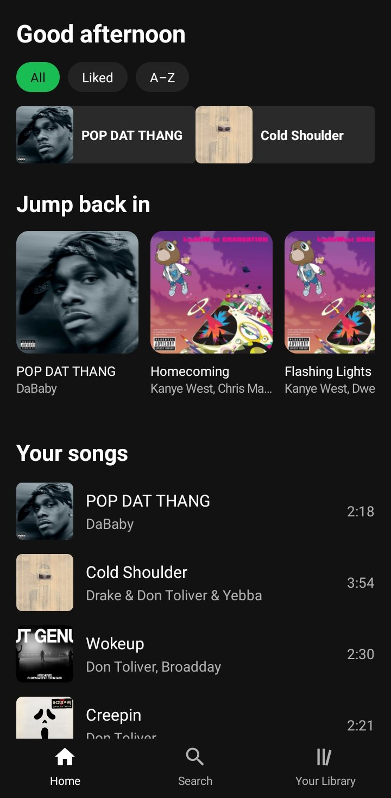
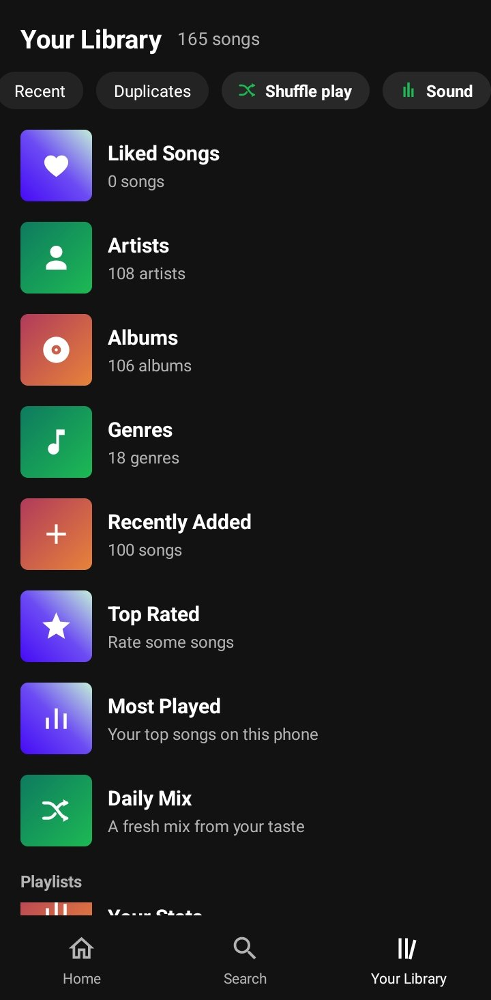
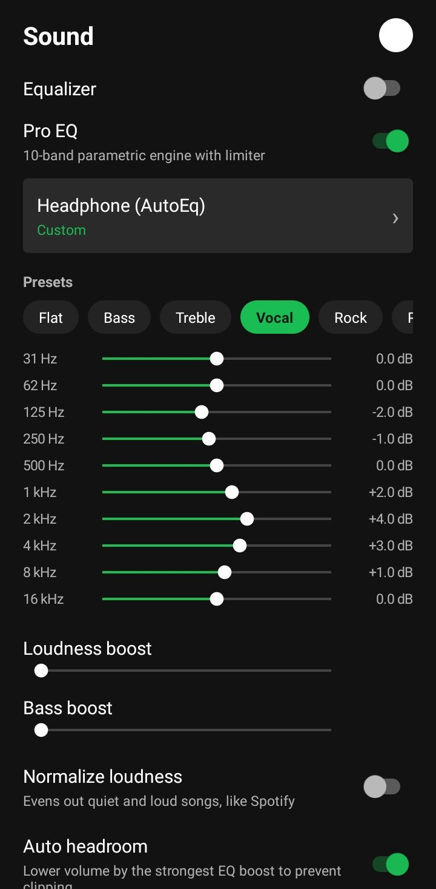

# اسپات‌پلیر (SpotPlayer)

یک موزیک‌پلیر اندرویدی با ظاهر و حس **اسپاتیفای**، برای **کتابخانه موسیقی خودتان** — بدون اکانت، بدون استریم، بدون آهنگ الکی. اسپات‌پلیر فایل‌های صوتی روی گوشی شما را (از طریق MediaStore) می‌خواند و با یک موتور پخش جدی و رابط کاربری تیره و آشنا پخش می‌کند.

> 🇬🇧 English README: [README.md](README.md)

> 📦 **فوق‌سبک:** کل برنامه فقط یک APK حدود **۷۶۰ کیلوبایتی** است — زیر ۱ مگابایت، با همه قابلیت‌های زیر.

[](https://github.com/xuneta/SpotPlayer/releases) [](https://github.com/xuneta/SpotPlayer/releases) [](LICENSE) 

## قابلیت‌ها

- **کتابخانه** — آهنگ‌ها، خواننده‌ها، آلبوم‌ها، ژانرها، تازه‌اضافه‌شده‌ها، برترین امتیازها (Top Rated)، پُربازدیدترین‌ها، Daily Mix، آهنگ‌های لایک‌شده، پلی‌لیست (به‌همراه «ذخیره صف به‌عنوان پلی‌لیست»)، جست‌وجوی گروهی، امتیاز ستاره‌ای، پیداکردن آهنگ‌های تکراری
- **موتور پخش** — Media3 / ExoPlayer با سه انجین برای کراس‌فید و پخش بدون وقفه (gapless)، شافل هوشمند (بر اساس علاقه‌مندی‌ها)، حالت‌های تکرار، کنترل سرعت، تایمر خواب، تکرار A–B، ردکردن آهنگ با تکان‌دادن گوشی، **حذف سکوت** اول و آخر آهنگ (نسخه ۵.۶)، حرکت‌های مینی‌پلیر — بکش بالا تا باز شود، بکش پایین تا پخش کامل متوقف شود (نسخه ۵.۶.۳)
- **صدا** — اکولایزر پارامتریک ۱۰ باند (DynamicsProcessing) با لیمیتر و هدروم خودکار، اکولایزر قدیمی به‌عنوان جایگزین، پروفایل‌های هدفون AutoEq، ReplayGain (اول از تگ‌ها، بعد اسکنر داخلی)، نرمال‌سازی بلندی صدا، بالانس استریو، ذخیره تنظیمات EQ برای هر خروجی
- **متن آهنگ** — از تگ‌های داخلی و فایل `.lrc` کنار آهنگ، هایلایت هم‌زمان با پخش، جست‌وجوی آنلاین از API رایگان LRCLIB با کش داخلی، ویرایشگر متن آهنگ
- **امکانات دیگر** — اسیک‌بار موجی (Waveform)، تم مشکی خالص AMOLED، آمار شنیدن، حالت ماشین (Car Mode)، ویجت صفحه اصلی، کنترل با دکمه‌های هندزفری، بوکمارک برای آهنگ‌های طولانی، گزارش‌گیر کرش داخلی (نسخه ۵.۶.۱)

## لایسنس

MIT — فایل [LICENSE](LICENSE) را ببینید.

## تصاویر

<p align="center">
  
  
  
</p>

## ساخت (Build)

اسپات‌پلیر **بدون Gradle** و با یک پایپ‌لاین دستی ساخته می‌شود:

```bash
export JAVA_HOME=/path/to/jdk21
bash build_manual.sh
```

اسکریپت به‌ترتیب aapt2، javac (با `--release 17`)، R8/D8، zipalign و apksigner را اجرا می‌کند و خروجی `SpotPlayer.apk` می‌دهد.

نیازمندی‌ها: JDK 21، پلتفرم ۳۴ و build-tools 34.0.0 از Android SDK. فایل‌های AAR مربوط به Media3 در پوشه `libs-media3/` هستند.

## مشخصات فنی

- جاوا خالص (فریم‌ورک اندروید) + Media3 ExoPlayer 1.11.1 — بدون کد AndroidX و بدون کاتلین
- پکیج: `com.arman.spotplayer` · حداقل اندروید: ۸ (API 26) · هدف: اندروید ۱۴ (API 34)
- نسخه فعلی: **۵.۶.۴** (versionCode 33)

## مجوز

پروژه شخصی است — سورس برای یادگیری و بررسی منتشر شده است.
